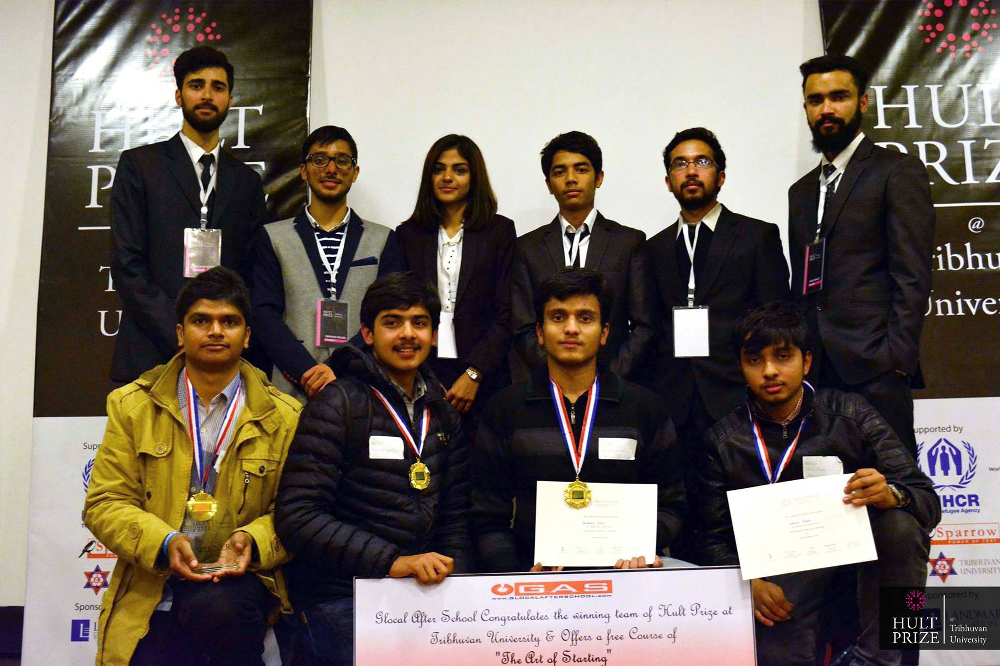
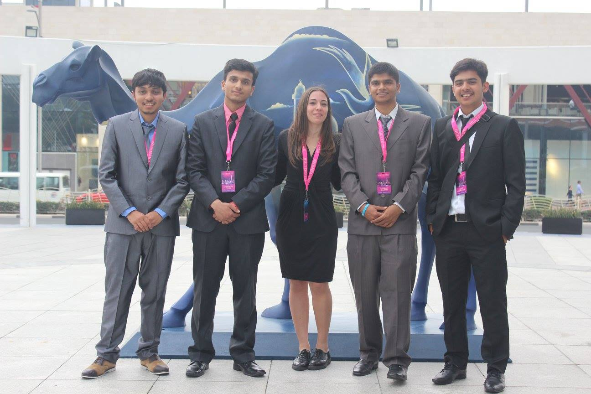
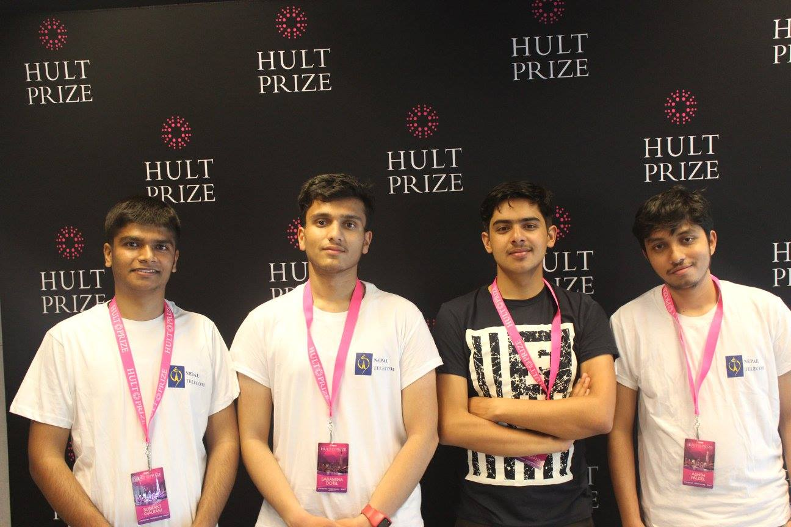
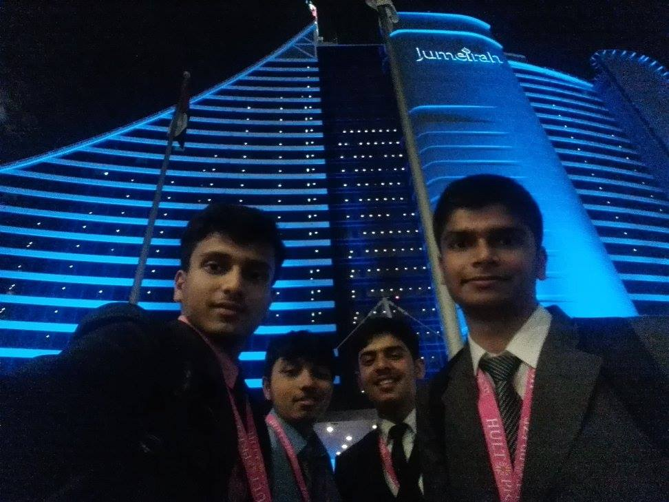

[Hult Prize](https://www.hultprize.org/) is an annual, year-long competition that crowdsources ideas from college students by challenging them to solve a pressing social issue. It is often touted as the biggest social entrepreneurship competition for students.

I participated in the **Hult Prize at Tribhuvan University** in 2017, where my team competed against student teams from various faculties inside Tribhuvan University. The winner of the competition earned a place at the regional finals in Dubai, UAE, the winner of which would advance to the global finals in New York, USA.

It was a surreal experience winning the Hult Prize at Tribhuvan University and participating in the regional finals in Dubai.

For the competition, we presented a prototype of an e-commerce platform targeted at micro-entrepreneurs. Aptly named **Product with a Story**, the idea was to give entrepreneurs from marginalized communities a way to sell their products directly to customers, with each product accompanied by the background story of its creator. So you would not just be buying a product but the heart and soul that went into making it.

