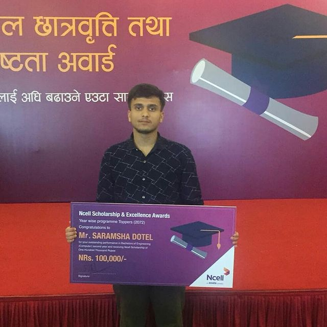

Ncell, a leading telecommunications service provider in Nepal, awards a scholarship to students at IOE, Pulchowk Campus as part of its CSR initiative. The award is given to students who score the highest aggregate marks in a given calendar year (i.e., two semesters).

I was fortunate enough to win the award on three occasions during my undergraduate:

- 1st year (2016)
- 2nd year (2017)
- 4th year (2019)

