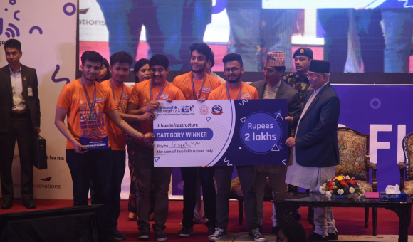
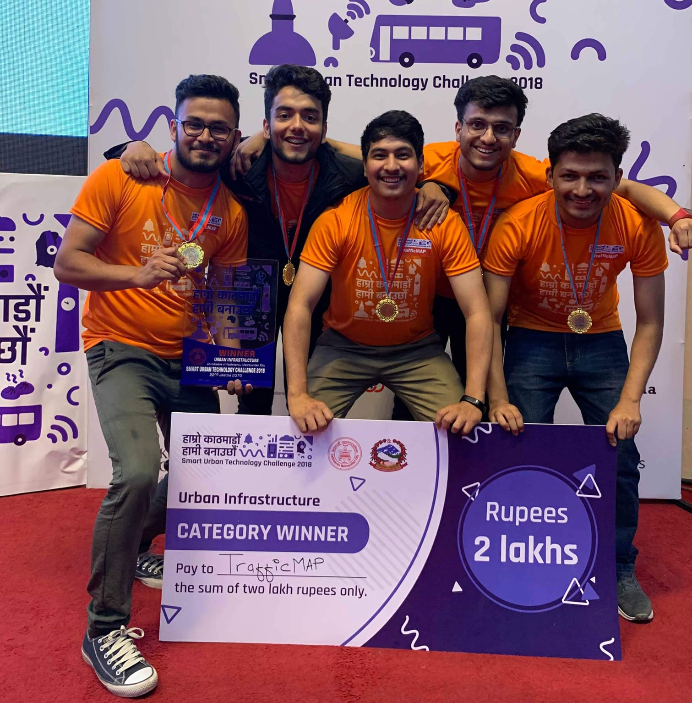

This was a [competition](https://kathmanduchallenge.org/) organized by the Kathmandu Metropolitan City of Nepal to engage youth in building innovative technological solutions across four broad themes:

- Urban Infrastructure
- Community and Environment
- Metropolitan Public Administration and Management
- Municipal Community Service

I teamed up with four good friends — **Ramesh Pathak**, **Barun Pandey**, **Avishekh Shrestha**, and **Anish Bhusal** — to develop a [Traffic Mobility Analytics Platform](/writing/traffic-map/), a software application that automatically detected, categorized, and counted vehicles in the road. We demonstrated the prototype on a traffic video feed of four major junctions in the Kathmandu Valley.

It was a great pleasure and honor to win the **Urban Infrastructure** category.

