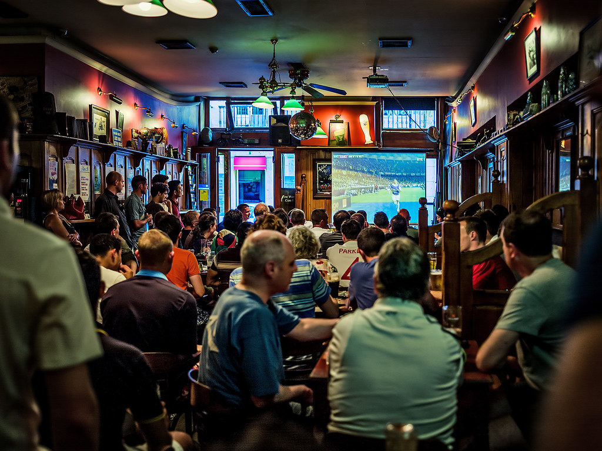
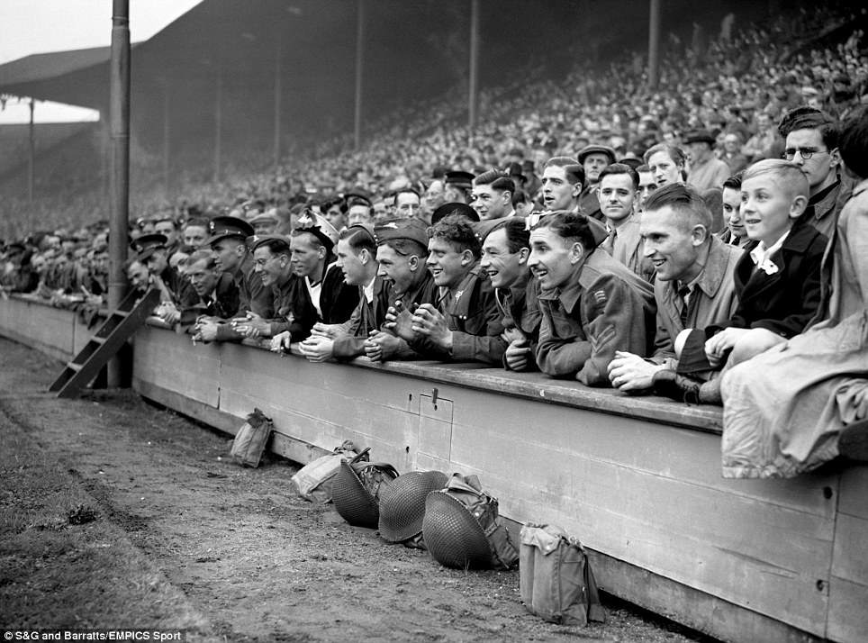
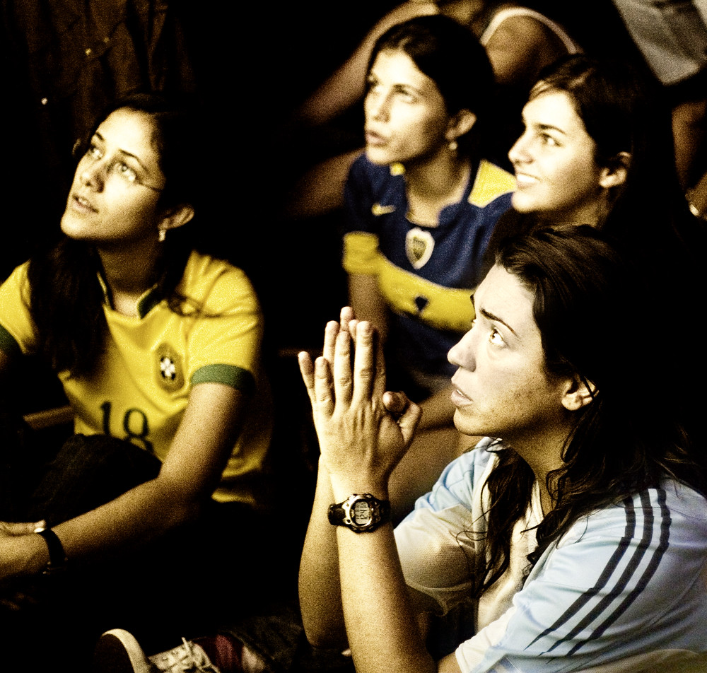

It is a cold chilly night in a suburban settlement in South Asia. Silence and darkness has enveloped the city as people are in deep slumber recovering from their day-time weariness.

On the third floor of a three storeyed apartment however, the light is still on. Inside of it sits a young man biting his nails in angst with an air of nervousness surrounding him. He is aloof of his intemperance eroding his nail tip as he fixates his eyes on the television. It is the Champions League Final and his favorite football team, Liverpool, are on the brink of clinching the elusive European silverware. A hairy Belgian drills the ball into the bottom corner of the post in a stadium 5000 miles away and amidst the deafening silence, the man leaps off his couch screaming and throwing his fists in the air, probably waking up his sleeping neighbor who mumbles curse words as he tries to fall asleep again.

So, as you might have guessed, this young gentleman is a **Sports Fan** (or as his sleep-deprived neighbor would call him: a **Crazy Sports Fan**). What happens next? Will the football club parcel him a shiny medal all the way from England? Or will he be awarded a raise in his office the next day? The answers to these questions render this narration anticlimactic. No, he isn't getting any of those. Instead, he will probably have a hard time waking up in the morning after barely getting an hour of sleep. It will be the same old routine, just another date in the calendar. If that is the case, what is the point of that man sacrificing his sleep (and probably his neighbor's)? Just to watch a spherical ball being passed around by grown men who aren't related to him by ethnicity, nationality, or religion? They don't even share the same time zone! But despite the clear and obvious irrationality, there are millions of people around the globe just like this man. This behavior is seen with any competitive sport, not only football. Fans of cricket, basketball, baseball — all are aboard this train of unrequited love, dedication, and sacrifice: **the train of Sports Fandom**.

For those of you who do not follow sports, you might be nodding along these lines. These are questions worth pursuing: Why do we pay astronomical amounts of money to people for excelling at a game with arbitrarily defined rules instead of investing that money in scientific research and engineering? Why do people waste their precious time watching sports instead of doing something productive and worthwhile? If you say it is a form of art, there seem to be better artforms to invest oneself into: music, songs, paintings that can actually convey important messages to society. The fanaticism around sports, however, seems to be a species-level design flaw. Or is it not?

**So, why are sports fans sports fans?**

> *Of all the unimportant things in the world, football is the most important.*
>
> — Pope John Paul II

The young man who disturbs the calmness of the night in the story above is actually me. As a lifelong follower of sports, I have pondered many times whether I have made a worthy investment of my time and emotions. I have wondered why I let myself succumb to frustration or elate with ecstasy due to the actions of eleven red jerseys in the North of England (even the players wearing the jerseys do not matter). But I had never really dug deep into what the science has to say about sports fandom. Is there a fitting reasoning that justifies my irrational-looking attachment? I strolled in the internet for a while to find answers.

# The Biology of Sports Fans

When a person is victorious in a competitive quest against a rival, his testosterone level rises while the person who lost has a momentary decrease. A similar effect is seen in females too, although less pronounced. It makes sense that athletes who are pitted against an opposition in a sport go through this hormonal fluctuation. However, biologists have made an interesting finding that fans, who simply watch the athletes play the game, also go through this hormonal rise and fall. In other words, fans live a **vicarious experience** of the game through the athletes by just watching them play. Lizette Borreli, a writer at [Medical Daily](https://www.medicaldaily.com/reporters/lizette-borreli), says that the *spectating brain* is also a *playing brain* when it comes to sports. When we're watching sports, it feels as if we're actually playing in the game. Journalist Eric Simons, the author of [The Secret Lives of Sports Fans](https://www.amazon.com/Secret-Lives-Sports-Fans/dp/1590208641), emphasizes the same by describing how sports fans see themselves as an extension of their team. According to him, referring to their teams as "we" isn't just an obnoxious thing fans do. Their brains are actually confused about what is "me" and what is the "team" as they mirror the feelings of the players and even their hormones.

Besides this hormonal wavering in triumph and defeat, while watching sports fans experience **eustress**: a beneficial stress with a touch of ecstasy. This accounts for better mental well-being for fans who regularly experience it.

# What Social Psychology says about Sports Fandom

Although biologists have interesting insights into what goes on inside the brains of sports fans, perhaps a more interesting discourse is found in the social psychology department. Psychologists and anthropologists have performed a number of experiments on different groups of sports fans and their findings reveal an interesting window into the fabric of human society and the human mind.

## 1. Escaping the dull and obvious

Imagine the daily life of a person who lives in a house that is too small, drives through a traffic that is too congested, works at an office that pays too little. Not everyone has a job that provides them with the urgency and motivation to anticipate what the next day is going to bring. For that person, a weekend game of his favorite sports team in the backdrop of majestic stadium floodlights provides something to look forward to. It provides him an escape from his repetitive routine, a thrilling and uncharted detour from the road that he has trodden past too many times to know every turn. Sports fans have higher than average meaning for life due to this. Had a rusty week? Relieve yourself by watching a group of men battling to find out who throws a ball the farthest by hitting it with a wooden bat.

## 2. The thirst for status gain

It is the innate characteristic of human beings to strive for that triumphant feeling in climbing up the status ladder. However, there are only a few places in this world where you get the sweet taste of victory and that fulfilling satisfaction of achieving something of worth. This leads people to the oasis that is sports, where they quench their thirst for victory and triumph by assimilating themselves into a bigger entity.

This behaviour is also known as **Basking in Reflected Glory** or **[BIRG](https://en.wikipedia.org/wiki/Basking_in_reflected_glory)**. In 1976, psychologist Dr. Robert Caldiani led a series of studies in major football (the American one) schools observing the behavior of fans with respect to the team they support. He introduced different terms to summarize these behaviors that have become colloquial in social psychology literature:

- **Basking in Reflected Glory (BIRG)** — fans of victorious teams develop a subconscious strategy to maintain a positive self-image by associating themselves with the winning team. They do so by donning team apparel, carrying banners and flags, and even painting their faces or tattooing their bodies.
- **Cutting off Reflected Failure (CORF)** — Caldiani observed that some fans of teams that lose develop a *feel-good* strategy by limiting their association with their team, at least for a time after the defeat.
- **Cutting off Future Failure (COFF)** — another interesting observation Caldiani made was that some fans develop the *Underdog Mentality* where they actively downplay their own team in the build-up to games for fear of the success being short-lived.

With the spread of technology, not only has the realm under which BIRGing or CORFing may fall increased, it has also increased the ease with which individuals partake in this status signaling. Twitter is one of the best places to observe this behavior. People have even given names to different factions of these users and their engagement. Football Twitter, Cricket Twitter, NBA Twitter, etc., have become a common tongue for regular Twitter users.

## 3. Belonging to a community

As social species, human beings have a primal longing for interpersonal relationships. Historian Yuval Noah Harari says that the capability of humans to form imagined orders that glue together large groups of people into a community or a nation is the major reason humans have dominated every other species on this planet in the Anthropocene epoch. If there's one thing that sports is better at than anything else in the world, it's creating communities that people can bond over. Sports — just like ethnicity, religion, and nationality — allows people to be part of something bigger than themselves: a shared identity and a feeling of belonging. The high frequency of sporting events and the glories and defeats that people experience only strengthen this feeling. In your casual evening stroll, if you come across a person wearing the jersey of the team you support, you automatically establish in your mind the shared experiences you both must have gone through in the past. This is not only an effective ice-breaker but it adds an extra degree of closeness, a feeling that they are *one of our own*.

People from different parts of Asia, where sports has not penetrated the fabric of society as much as Western and European counterparts, do not realize this, but sports are a coveted family tradition. Supporting a sports team is passed down through generations, almost like heredity, and the majority of sports clubs are native to a particular community or part of a city. If you read about the history of the United Kingdom after the industrial revolution in the late 1800s, you'll find that sports was the glue that held communities of working-class laborers.

After a hard ordeal at the mill for a week, a young Englishman in his thirties goes to the nearby field to watch the weekend football match of his community club. Many of the players are his own mates, whose houses are within walking distance of his own. He and the goalkeeper even shared the same morning bread for the most part of his childhood. Today is a special day. His five-year-old son has tagged along with him to what would be his first football match. And back home, his octogenarian father, who can no longer walk to the game, sits out at the porch awaiting his son and grandson to bring him the details. The crowd gathers in thousands and starts singing in the stadium like wartime soldiers and sailors bellowing at the top of their lungs. On their way back home, they visit a local pub for a pint and share a laugh together.

### An analogy to religion

> *Soccer isn't the same as Bach or Buddhism. But it is often more deeply felt than religion, and just as much a part of the community's fabric, a repository of traditions.*
>
> — Franklin Foer, [How Soccer Explains the World](https://www.amazon.co.uk/How-Soccer-Explains-World-Globalization/dp/0061978051)

Anthropologist Harvey Whitehouse conducted several studies on the traditional rituals and beliefs of religious groups in Papua New Guinea that manifest as social identity and bond. One of his findings was that small, tightly-knit religious groups have rituals that are emotionally and physically more demanding, and this ordeal brings them closer. He draws an analogy with sports fans. Supporters of clubs that have gone through painful defeats and downfall are seen to be more empathetic to each other and share a heightened sense of belonging.

### It's not always about winning

While Caldiani was right in observing that people support sports teams to bask in their reflected glory, it would be unfair to assume that all fans are in this solely for the thirst of glory and triumph. Psychologist Daniel Wann sheds some light on why sports fans support so ardently even when there is a chance the outcome might not be in their favour. He claims that **"belonging is more important than winning."** It is not only about the status gain that comes along with victory but also about the experience and identity that the teams market. If you see yourself as a member of a family, that role doesn't change. Those types of connections are very long-lasting and very strong. This explains why fans stay loyal to their teams even when they don't win a single silverware for decades and there are other highly successful teams they could have identified with to get a taste of victory and triumph. The Chicago Cubs, an American professional baseball team, went a staggering 108 years without winning the World Series championship, but that wasn't reason enough for its faithful following to give up on them. Similarly, supporters of Liverpool FC endured a 30-year drought of the English League title and painfully observed their descent from European elites of the game to struggling plebeians.

Dr. Wann also states that in doing so, **sports fans have perfected a method of coping**. If they weren't able to cope, there would be no sports fans. Some fans use loyalty signaling as a way of coping with relentless failures. Some choose to reflect on past glory years and wistfully long for the *good old days*. Some even resort to **superstition as a coping mechanism**. There are fans that always wear the same clothes, sit on the same couch, or make twenty rounds of their living room in anti-clockwise fashion before the game starts. They are effectively hinging their emotions on something they have no control over. Superstition helps to provide them a (false) sense of control over the situation.

In fact, in modern days, clubs that cannot provide a winning experience to their fans pivot to other techniques that keep the fans attached to them. They try to market a humane experience by inviting fans to a tour of the stadium, engaging through social media, and establishing charitable foundations to portray themselves as more of a communal entity than an athletic sporting institution.

## 4. Us vs Them: a tribal instinct

Sports fanaticism taps into the creepy tribal side of human beings, which likes to watch people fight each other to death. In many ways, the Romans enjoying the bloodbath of the gladiators in the Colosseum is similar to contemporary people watching a competitive sporting event in large stadiums where the possibility of players getting injured or engaging in a fist brawl provides an unscripted and unadulterated adrenaline rush.

Furthermore, sports provides a constructive outlet to our tribalist tendencies of **us vs them**. For many years in human history, tribes of people waged wars against other groups that didn't adhere to their religion, beliefs, or culture. We are wired at birth to favor our own group over others. Evolutionary psychologist John Tooby has called this **"identity craze"**, and we can't help but be victims of it, especially when we feel threatened. In any other cultural context, putting down the "other" has grave consequences. Political partisans berating the opposition leader or her supporters are judged with contempt. They are said to be troublemakers that thwart politics from being a peaceful and rational discussion. Similarly, any pejorative against another faith or religion is an immediate threat to the religious tolerance of society. But when a Real Madrid fan curses a Barcelona supporter to suffer in hell and makes divisive remarks that he and his troops are inherently superior with a richer history than the young bloods of Catalonia, nobody bats an eye. In other words, sports provides a relief valve for our tribal emotions in a low-risk setting. We can sow the seeds of rivalry and hostility without reaping grave consequences or worrying about reparations. Sports allows us to experience **schadenfreude**, a feeling of joy in others' misery, without being questioned about our morality and ethics.

## 5. Evolutionary drivers

An interesting comment I came across while going deep into the rabbit hole on a subreddit about sports psychology was that maybe there are evolutionary drivers that make humans watch sports purely from a mechanical point of view. Most of the sports where fans exhibit jingoist fanaticism and tribalist tendencies are physical contact sports — sports related to kicking and throwing things. So could it be that our mid-brain is fascinated because it draws parallels to the physical hunting prowess of our ancestors?

# The Dark Side of Fanaticism

While we mention the communal belonging and mental well-being that sports caters to its followers, we cannot overlook the jingoist fanaticism and violence that sports has helped to breed over the years. Just like any other following, there are bad apples among sports followers too. And something that adds no other materialistic value to the lives of people has turned into a bloodbath for many people who let their tribalist tendencies get the better of their conscience. There is a special term for such fans: **hooligans**.

Social psychology has attempted to provide a justification for this set of fans who support their teams with extreme fervor. Supporting a sports team as part of a community gives people a sense of **deindividualization** — a feeling that when in a group, the actions they carry out will go unnoticed and will be attributed to a larger entity or for a greater cause. This causes **disinhibition**, and people who under normal circumstances would refrain from violence pivot to it as the herd mentality blinds them from foreseeing the repercussions of their actions.

Significant steps have been taken by authorities that govern sporting events to curtail hooliganism among fans. For instance, the English Premier League has banned fans from taking alcoholic beverages to the stands while watching the game. However, there still exist factions of football supporters, especially in the Balkan region, labelled as *Ultras*, who are notorious for their violent temperament inside or outside the stadiums. Sports like American football, baseball, and basketball also suffer the same fate.

Perhaps less concerning, but still a pertinent issue, is **in-group bias** among sports fans. Fans are much more likely to defend the shortcomings of their favorite player or favorite team. Just like we tend to forgive and overlook the wrongdoings of our family members, sports fans try to bend the narrative that criticises their team. This can be linked to the observations of psychologists discussed above. Fans see their teams as an extension of themselves. Nobody would like to be associated with a player that is allegedly involved in sexual harassment or with a club that exploits its blue-collar workers. Fans try hard to dismiss or defend such acts by their teams. But they jump into making accusations if it's their rivals instead.

# Is Sports Fandom a Conspiracy?

While there are people indifferent to sports fanaticism, there are some who harshly criticize the trend of supporting a sporting institution. They have even concocted elaborate conspiracy theories that sports fandom is a quintessential example of how people have become slaves to modern capitalism. Noam Chomsky, the great American linguist and philosopher, says in this [video](https://www.youtube.com/watch?time_continue=55&v=2sX1H9FxMms&feature=emb_title) that encouraging people to support a sports team is a way of building in people an irrational submissiveness to power. He claims that modern sport fanaticism cultivates jingoist attitudes in people. It has been structured by the elites in such a way that people get engrossed in entertainment by something insubstantial and in due course, do not question the things that matter. He expresses his disappointment over the fact that many people are not as aware of the foreign policies or political agendas of importance in society as they are about the results and statistics of teams that play a made-up game of no value. He argues that people's time is better spent holding governments accountable and contributing to a more fruitful cause than submitting to yet another modern capitalist bandwagon.

Perhaps it is true that if everybody invested their time spent watching sports into critiquing the government and discussing issues that actually affect human lives like climate change, we might solve such problems sooner. It is also true that compared to teachers, scientists, and researchers, athletes are paid astronomically high amounts of money that aren't justified when looking at their roles in driving humans forward as a civilization. But as the social psychologists have put it, following sports is a characteristic we have developed by the process of evolution as a species over thousands of years. Humans, as a species, are wired to resort to sports fanaticism in one way or another.

# For the Love of Sports

For the past decade and the better half of the decade before that, I have been an ardent follower of different kinds of sports, particularly football. Having read what expert psychologists and anthropologists had to say about this behavior of mine, I pondered which of these reasons actually instigate me to continue watching sports despite it becoming more and more obvious that it is inconsequential to what happens in my life.

## A roller-coaster ride of pure emotions

Sports sends you jumping around your house in one minute and burying your teary eyes in the pillow the next. To the best of my knowledge, I cannot think of anything else that can provide such intense, starkly contrasting emotions at such high frequency. A good 90-minute football match has it all: the burgeoning heartbeat as the opponents near your team's goalpost, the sudden weightlessness when a ball soars away from the post just kissing the tip, the feeling of hopelessness when the rivals are outwitting your team with a possessive tiki-taka, the sense of elitism when a player from your team humiliates an opponent with a cheeky skill, the anger when a player misses a goal from three yards for the third time in the match, the ineffable euphoria when a shot from 30 yards out screams past the keeper into the back of the net, and the crushing blow of conceding an injury-time goal. Watching sports as an ardent supporter sends you to that silent mental state of awareness where you are one with everything and everyone around you.

## A transcendental bond

Besides the actual sporting activity, fans spend a lot of time following the activities of their team off the field. Sports allows you to form a bond with something that transcends your life — something immortal. It allows you to partake in the unfolding of a historical event, a story that people are probably going to talk about for years to come. It teaches you to love, to care, to worry, and feeds you a story to look forward to. It is like watching a painter paint and speculating where the next stroke of the brush will be.

But still, this doesn't keep you from asking: **how is something so important in life so entirely out of control?** This is where I am reminded of what John Green said in one of his podcast [episodes](https://www.wnycstudios.org/podcasts/anthropocene-reviewed/episodes/anthropocene-reviewed-teddy-bears-and-penalty-shootouts) about penalty shootouts:

In some ways, this is life itself. You are never really steering the ship of your life. You are shouting to the unseen captain: "Please turn this way. Please turn that way. Please avoid that iceberg." Sometimes the captain listens and you might reach a beautiful archipelago where you get to spend a week. But sometimes the captain doesn't listen and all you can do is cope with it and hope the next turn takes you to a beautiful coastline instead of a frightening seastorm.

# References

- [The Science of Being a Sports Fan](https://www.smithsonianmag.com/innovation/the-science-of-being-a-sports-fan-9227430/), *Megan Gambino, Smithsonian Magazine.*
- [To Understand Religion, Think Football](http://nautil.us/issue/39/sport/to-understand-religion-think-football-rp), *Steve Paulson, Nautilus.*
- [The Unique Neurology of the Sports Fan's Brain](http://nautil.us/issue/39/sport/the-unique-neurology-of-the-sports-fans-brain), *Brian J. Barth, Nautilus.*
- [Why Sports Fans see their teams as an Extension of themselves](https://www.washingtonpost.com/opinions/the-psychology-of-why-sports-fans-see-their-teams-as-extensions-of-themselves/2015/01/30/521e0464-a816-11e4-a06b-9df2002b86a0_story.html), *Eric Simons, Washington Post.*
- [Sports Complex: the science behind fanatic behavior](https://www.psychologicalscience.org/observer/sports-complex-the-science-behind-fanatic-behavior), *Shirley Wang, Association for Psychological Science.*
- [Why Sports Fans are Sports Fans](https://waitbutwhy.com/2014/03/sports-fans-sports-fans.html), *Tim Urban, Wait But Why.*
- [Why do we see so many things as "Us vs Them"?](https://www.nationalgeographic.com/magazine/2018/04/things-that-divide-us/), *David Berreby, National Geographic.*
- [TEDx video on the psychology of sports fans](https://www.youtube.com/watch?v=q2bhskk17ng)
