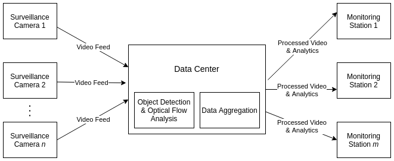
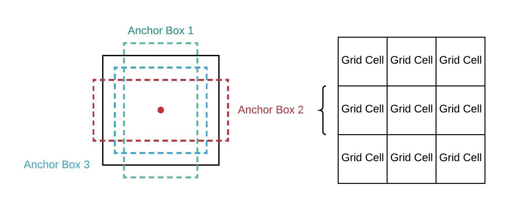
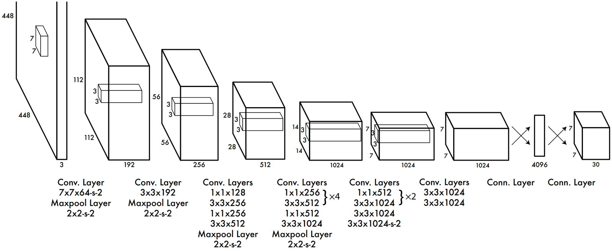
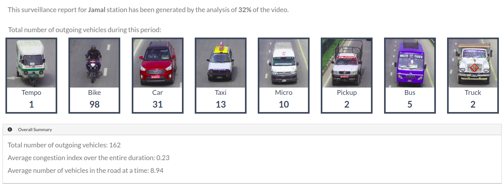
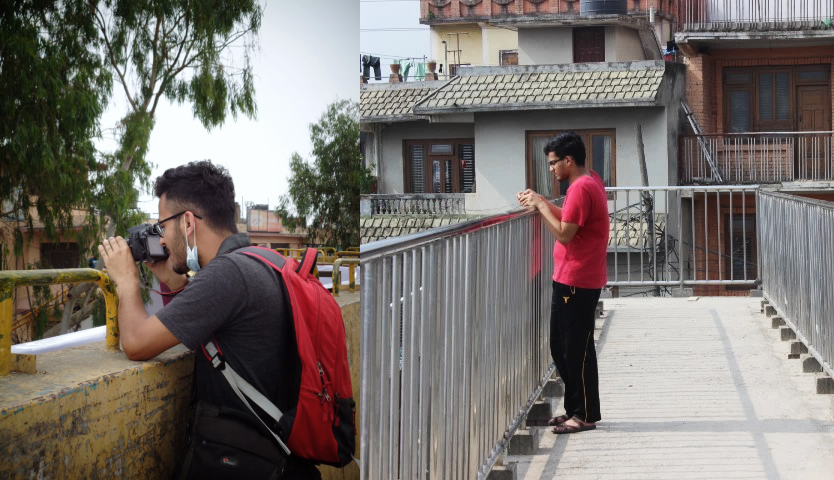
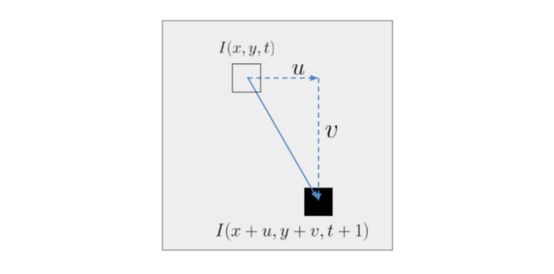
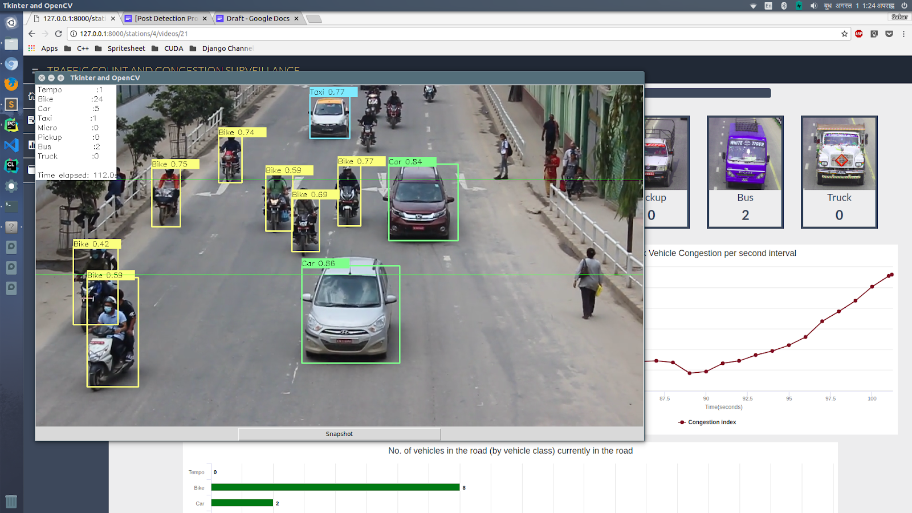
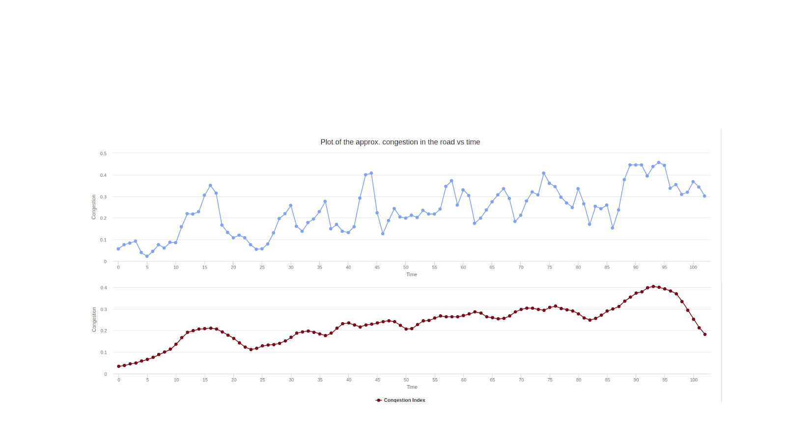

*The following is an account of one of the projects I worked on during my undergraduate years. It outlines the problem we were trying to solve, the technical details behind the system we developed, and my experience and learnings from the project.*

With the advent of deep learning, the field that has arguably been hyped the most in recent years is computer vision. The ability to understand the elements and activities in a still image or a moving video presents endless opportunities for digitizing aspects of human life that were not possible previously. One such example is understanding the flow of vehicle traffic in the road solely through surveillance cameras. This is the problem we attempted to tackle as our undergraduate minor thesis.

# Problem statement

The primary task is to build a system for analysing traffic mobility patterns on the roads of Kathmandu, Nepal. Understanding the vehicle traffic in a road entails two primary tasks:

- **Vehicle detection**, or in general object detection, which further encompasses two sub-tasks:
  - **Classification** — categorize the vehicle into one of many categories like bus, car, taxi, motorbike, truck, etc.
  - **Localization** — simply classifying the vehicles won't cut it. We should also be able to localize their position in the frame: identify a bounding box that encloses the vehicle.
- **Vehicle tracking** — traffic is ever moving. We need to track the movement of vehicles in the road. For this project, we decided to only count the number of vehicles that went past the camera. Measuring their velocity could have been an enhancement.

# System overview

Before diving into the technical details behind the solution we developed, it helps to have a bigger picture of the problem we were attempting to tackle and discuss what an ideal system could look like.



The system consists of three major components:

- **Surveillance cameras** — placed on the road, supplying the video feed to the data center.
- **Data center** — where the video data is stored and processed. Detection and tracking of vehicles in the video frame happens here. The resulting data is then aggregated to produce human-readable information for analysis.
- **Monitoring station** — the client side of the application. The processed video (with the detected vehicles) is shown along with an informative dashboard to help the users make sense of the traffic mobility pattern. It displays:
  - The real-time count of vehicles (categorized by type) on the road.
  - The plot of road occupancy against time elapsed.

# Task 1: Vehicle Detection

If you have anything to do with images (videos are simply a stream of images), **convolutional neural networks (CNNs)** are the de-facto standard in deep learning. Specifically for **object detection**, we employed a **YOLOv2** network. YOLO (You Only Look Once) is a CNN architecture tailored to detect objects in an image at lightning speed. I'll only superficially describe the working of this architecture to maintain brevity. For a rigorous technical treatment, please refer to:

- [YOLOv1 paper](https://arxiv.org/pdf/1506.02640.pdf)
- [YOLOv2 paper](https://arxiv.org/pdf/1612.08242.pdf)

### YOLO in brief

Traditionally, object-detection algorithms worked by running classifiers on parts of the image in a sliding window. This was the case for architectures like Faster R-CNN. While they boasted high accuracy, the inference time was too slow to be feasibly used for real-time object detection from video. YOLO transformed the literature by framing object detection as a regression problem. The result is **faster inference with a small tradeoff in accuracy**.

YOLOv2 is an improvement on the older YOLO architecture and is the state of the art on standard detection tasks like *PASCAL VOC* and *COCO*. At 67 FPS, YOLOv2 gets 76.2 mAP on *VOC 2007*; at 40 FPS, YOLOv2 gets 78.6 mAP. It outperforms Faster R-CNN with ResNet and SSD while still running faster than them.

#### What does YOLO output?

![YOLO divides the image into [S x S] grid; each grid has B bounding box predictions along with their confidence and class probabilities](/assets/img/traffic/yolo_output.jpg)

YOLO divides the image into an `S × S` grid. Each grid cell has `B` bounding-box predictions. Each bounding-box prediction is represented by a vector of length 5. This vector includes all the information needed to represent the prediction:

- `(x, y)` — the coordinates of the center of the box relative to the grid cell.
- `(w, h)` — the width and height of the box relative to the entire image.
- `P(obj)` — the confidence score, or the probability that there is an object in the box.

The object (if present) in the grid cell could belong to any of the `k` classes. Each grid cell also predicts a class-conditional probability vector `C = [C_1, C_2, ..., C_k]` where `C_i = P(Class_i | Object)`. Consequently, `P(obj) * C_i` gives the probability that an object of class `C_i` exists in the box.

#### The concept of anchor boxes



A square bounding box is not always the best choice for the different shapes of objects we might need to detect. For instance, trees are better demarcated by vertical rectangles, while a car might need horizontal rectangles. YOLOv2 uses **anchor boxes** as a solution, which differentiates and improves it from its predecessor. Anchor boxes are a set of boxes with predefined width/height ratios. Instead of directly predicting the bounding-box coordinate, we predict the offsets for these boxes such that they will enclose an object. To pick the best choice among these boxes, YOLO uses **Intersection over Union (IoU)**: the extent of overlap between the predicted bounding box and the ground-truth bounding box, valued in `[0, 1]`.

Effectively, for each box we can calculate `P(obj) * C_i * IoU`, which gives the **probability of an object of a particular class appearing inside that box and how precise those box coordinates are in demarcating the object**.

#### The network architecture



The architecture of YOLOv1 consists of elements you'd typically see in a CNN architecture. It has a series of convolutional layers with maxpool layers in between. YOLOv2 architecture has slight modifications:

- It includes **batch normalization** layers that normalize hidden layers, which is proven to make the network train faster and decrease internal covariate shift.
- It omits the fully connected layers at the end to use anchor boxes instead. The output feature map is `13 × 13`.

#### Loss function

The prediction of a YOLO network can be divided into three groups:

- `[x, y, w, h]` for **localization**.
- `P(obj)` — the **confidence score** on whether an object is present.
- `C` — class-conditional probabilities.

Loss is calculated separately for each and combined together:

- **Localization loss** — sum of squared errors for `(x, y)` and `(w, h)`. The loss is configured to penalize only those boxes that have the highest IoU.
- **Confidence loss** — also a SSE loss, upweighted for boxes that contain an object and downweighted for those that don't.
- **Classification loss** — also SSE loss, capturing errors in predicting the class-conditional probabilities.

The mathematical formulation of the loss function is involved; I'd suggest the interested reader check out the original [paper](https://arxiv.org/pdf/1506.02640.pdf) for a detailed description.

## The nuances of dealing with Nepali vehicles

A machine-learning model is only as good as its data. We cannot expect the model to perform well on data that are not representative of the data present in the training set. We experienced this problem first-hand: vehicles in Nepal are quite different from what you'd see in Western countries. For instance, Western countries have far fewer motorbikes on the road, whereas Nepal has 10 motorbikes for every car. Similarly, the buses, trucks, and taxis are quite different in appearance. While the standard *ImageNet* and *COCO* datasets have images of standard vehicles, we needed a dataset of Nepali vehicles.



We captured footage of vehicles at major intersections in Kathmandu and collected and annotated a dataset consisting of 10,000 images. The vehicles were categorized into the following 8 classes:

**Taxi**, **Tempo**, **Motorbike**, **Car**, **Microbus**, **Pickup Truck**, **Truck**, **Bus**.



# Task 2: Vehicle Tracking

Having figured out a way to classify and localize vehicles in the frames of the video, the next task was to track individual vehicles across frames. We need to do this to count the total number of vehicles that moved past the surveillance camera. This will ultimately let us calculate the extent of road occupancy and provide real-time traffic monitoring to the end user.

Moving objects are tracked by a technique called **optical flow**. We implemented the **Lucas–Kanade optical flow algorithm** in OpenCV to track the moving vehicles on the road.

## Optical flow

Optical flow is the apparent motion of objects, surfaces, or edges based on the relative motion of the camera.



Consider a pixel that moved from `(x, y)` at time `t` to `(x + u, y + v)` at time `t + 1`. `I(x, y, t)` represents the intensity of the pixel at position and time `(x, y, t)`, and `I(x + u, y + v, t + 1)` is the intensity at the new position and time.

Given the position of the pixel in two frames, it would be fairly easy to calculate the velocity and hence track the movement of the vehicle. We already have the bounding boxes given by YOLO. All we need to do is track the centre of this bounding box for each vehicle. Right?

The problem is that **we cannot easily associate a pixel in frame `t + 1` with the pixel in frame `t`** such that both pixels represent the same object. Optical flow aims to solve this by making two assumptions:

- **The movement of the pixel is small** — the "moved" pixel in frame 2 lies within the neighborhood of the pixel in frame 1.
- **The intensity of the pixel doesn't change** from frame 1 to frame 2 (and from position 1 to position 2). At least, not by much.

Mathematically:

```
∂I/∂t + (∂I/∂x) · u + (∂I/∂y) · v = 0
```

Or, simplifying notation:

```
I_t · 1 + I_x · u + I_y · v = 0
```

This system cannot be solved as-is — it has two unknowns and one equation. So we make another assumption: a bunch of pixels within a neighborhood move with the same velocities `(u, v)` from `t` to `t + 1`. This gives us a number of equations like the one above, and we can solve for `(u, v)` using least squares:

```
A · X = B
X = (Aᵀ · A)⁻¹ · Aᵀ · B
```

We used the centre of the bounding boxes given by YOLO as the points to track. The above algorithm predicts the most probable location a particular point will reach in the next frame, and this is used to track the vehicles' movement throughout the video.

# Final Result

Finally, we had the system in place, performing the two most important tasks:

- Detecting vehicles on the road.
- Tracking the movement of a vehicle throughout the screen.

We then developed an analytics dashboard for the **monitoring station** that surfaced traffic-mobility information for any road. Some of the details presented:

- The **total count** of vehicles, categorized by type.
- The **extent of road occupancy** — how congested the road looks at a particular time.
- Identifying **which periods of the day are the busiest**. Vehicle count and road occupancy were taken into consideration for this.





# Learnings and Experiences

This was a transformative project for me. It helped me sink my teeth into the field of computer vision, and especially helped me realize how challenging it is to collect and prepare a custom dataset and fine-tune a model to perform as expected.

We demonstrated this project to the Metropolitan Traffic Division at Kathmandu, where it was well received.

We also won the [Smart Urban Technology Challenge 2018](/achievements/smart-urban/) with this very project.

All in all, it was a wonderful experience taking this project from idea to implementation.
